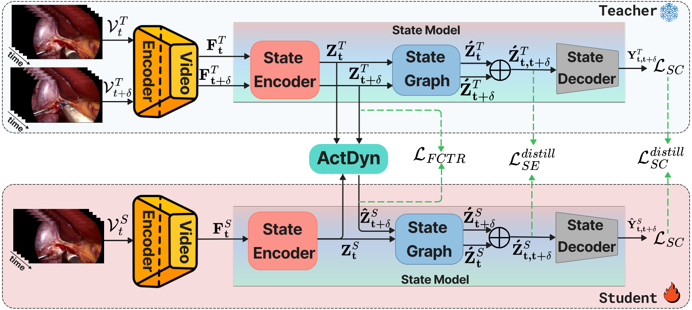
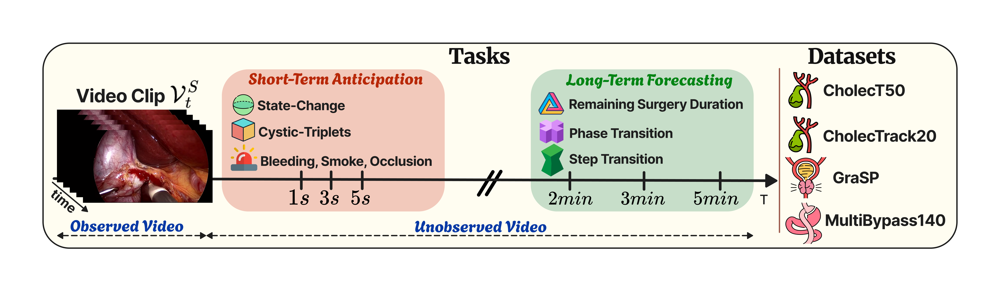

<div align="left">


# SurgFUTR: State-Change Learning for Prediction of Future Events in Endoscopic Videos
Authors: [Saurav Sharma](https://srv902.github.io), [Chinedu Nwoye](https://nwoyecid.github.io/), Didier Mutter, [Nicolas Padoy](https://camma.unistra.fr/npadoy/)

<br clear="left"/>
</div>

## 📋 Abstract
Surgical future prediction, driven by real-time AI analysis of surgical video, is critical for operating room safety and efficiency. Future prediction could provide actionable insights into upcoming events, their timing, and associated risks—enabling better resource allocation, timely instrument readiness, and early warnings for emergent complications (e.g., bleeding, bile duct injury).
Despite this need, current surgical AI research focuses on understanding what is happening rather than predicting future events. Existing methods target specific tasks such as phase or instrument anticipation in isolation, lacking unified approaches that span both short-term (action triplets, surgical events) and long-term horizons (remaining surgery duration, phase/step transitions).
These methods rely on coarse-grained supervision at the phase or instrument level, while fine-grained surgical action triplets and steps remain underexplored despite their potential to capture nuanced temporal dynamics. 
We address these limitations by reframing surgical future prediction as state-change learning. Rather than forecasting raw observations directly, our approach classifies state transitions between current and future timesteps, building transition-aware representations that that improve generalization across tasks and procedures.
In this work, we introduce SurgFUTR, implementing this paradigm through a teacher-student architecture. Video clips are compressed into state representations via Sinkhorn-Knopp clustering; the teacher network learns from both current and future clips, while the student network predicts future states from current observations alone, guided by our Action Dynamics (ActDyn) module that models state transition patterns.
For comprehensive evaluation, we establish SFPBench, spanning five prediction tasks across different temporal horizons: short-term anticipation (cystic-structure triplets, surgical events) and long-term forecasting (remaining surgery duration, phase/step transitions).
Across four datasets spanning three laparoscopic procedures, SurgFUTR provides generally favorable and often competitive performance relative to strong baselines, with the clearest gains on several long-horizon and fine-grained anticipation tasks. Cross-procedure transfer from cholecystectomy to gastric bypass further shows encouraging, though task and center-dependent, generalization.

## 🎯 Objectives
1. **State-Change Learning Formulation:** We introduce a state-change learning objective that unifies future prediction across multiple anticipation horizons by learning anticipative features from temporal state transitions.
2. **SurgFUTR Architecture:** We develop SurgFUTR, a teacher-student framework that models semantic transitions between current and future video clips, training the student to predict future states from present observations through our novel ActDyn module.
3. **Surgical Future Prediction Benchmark (SFPBench):** We introduce a comprehensive benchmark spanning multiple surgical procedures and annotation granularities.
4. **Comprehensive Evaluation:** We present extensive evaluation across SFPBench using complementary metrics and ablation studies to analyze the contribution of the proposed framework components.
5. **Cross-Procedure Transfer Learning:** We demonstrate effective transfer of state-change pretrained models from cholecystectomy to gastric bypass procedures, validating generalization across different surgical contexts.

## 📰 News

- [ ] Pretrained weights for the models used in this work
- [x] `2026-07-08` Scripts to generate the SFPBench dataset
- [x] `2026-07-08` First code release

## 🛠️ Installation
SurgFUTR is built on top of [MMAction2](https://github.com/open-mmlab/mmaction2). Please strictly follow the guidelines in the [MMAction2 installation instructions](https://mmaction2.readthedocs.io/en/latest/getting_started.html#installation) to set up the environment. After setting up MMAction2, clone this repository and install the required dependencies:

```bash
git clone https://github.com/CAMMA-public/surgfutr
cd surgfutr
pip install -r requirements.txt
```

## 🗂️ Directory Overview

```text
surgfutr/
├── assets/                     # README figures and visual assets
├── configs/                    # Pretraining and downstream task configs
│   ├── _base_/
│   ├── downstream_tasks/
│   ├── phase_recognition/
│   └── state_change/
├── data/                       # Annotation files and dataset metadata
│   ├── cholectrack/
│   ├── hct_triplets/
│   ├── mbp140/
│   ├── rarp_state_change/
│   └── state_change/
├── preprocessing/              # Dataset preparation scripts and instructions
│   ├── cholectrack20/
│   ├── mbp140/
│   └── state_change_analysis/
├── scadyn/                     # Models, datasets, and evaluation code
│   ├── datasets/
│   ├── evaluation/
│   └── models/
├── videos/                     # Extracted clips or local video assets
├── weights/                    # Pretrained and downstream checkpoints
├── work_dirs/                  # Training outputs and experiment logs
├── requirements.txt
├── LICENSE
└── readme.md
```

Place extracted dataset clips or frames inside the `videos/` folder. Place
pretrained model checkpoints and downstream task weights inside the `weights/`
folder.

## 📊 Method


## SFPBench Construction


To construct the SFPBench datasets, see the `preprocessing/` folder. It
contains dataset-specific instructions and scripts for preparing each dataset
used in this repository.

If you want to start with state-change pretraining, begin with the CholecT50
preprocessing pipeline in `preprocessing/state_change_analysis/cholect50/`.
That folder contains the scripts and [`instructions.md`](preprocessing/state_change_analysis/cholect50/instructions.md)
needed to:

1. generate the JSON metadata for state-change clips,
2. extract the corresponding clips from the source videos, and
3. add downstream labels such as RSD and phase transition labels.

In practice, the state-change pretraining pipeline starts by preparing both the
clip files and their JSON metadata first, and then using those information for
training.

### Single-Center Datasets

- [Cholec80](https://github.com/CAMMA-public/TF-Cholec80)
- [CholecT50](https://github.com/CAMMA-public/cholect50)
- [CholecTrack20](https://github.com/CAMMA-public/CholecTrack20)
- [GraSP](https://github.com/BCV-Uniandes/GraSP)

### Multi-Center Dataset

- [MultiBypass140](https://github.com/CAMMA-public/MultiBypass140)

### ⚖️ Usage Note

Please follow the license terms, access conditions, data use agreements, and
any other regulations provided by the maintainers of each dataset before
downloading, preprocessing, or using the data.

## Scripts

### Training and Testing

Set `PYTHONPATH` to the repository root before running training or testing:

```bash
export PYTHONPATH=<YOUR_PATH>/surgfutr
```

#### State-Change Pretraining

**Train** a teacher model on current and future clips:

```bash
CONFIG=configs/state_change/centroid_transition/teacher/t_vits_videomae_verbsc_256d_k25g_seed981.py

mim train mmaction $CONFIG --gpus 2 --launcher pytorch \
    --work-dir work_dirs/t_vits_videomae_verbsc_256d_k25g_seed981

# test
mim test mmaction $CONFIG --gpus 2 --launcher pytorch \
    --work-dir work_dirs/t_vits_videomae_verbsc_256d_k25g_seed981 \
    --checkpoint work_dirs/t_vits_videomae_verbsc_256d_k25g_seed981/best*
```

Train the distillation model using current clips and the teacher model:

```bash
CONFIG=configs/state_change/centroid_transition/best_model/ts_vits_vsc_k25_igtr33_m2p5_s18.py

mim train mmaction $CONFIG --gpus 2 --launcher pytorch \
    --work-dir work_dirs/ts_vits_vsc_k25_igtr33_m2p5_s18

# test
mim test mmaction $CONFIG --gpus 2 --launcher pytorch \
    --work-dir work_dirs/ts_vits_vsc_k25_igtr33_m2p5_s18 \
    --checkpoint work_dirs/ts_vits_vsc_k25_igtr33_m2p5_s18/best*
```

#### Downstream Future Prediction Tasks

##### SFP-I: RSD

```bash
CONFIG=configs/downstream_tasks/remaining_surgery_duration/baselines_default_weights/dino_r50_backbone.py

mim train mmaction $CONFIG --gpus 2 --launcher pytorch \
    --work-dir work_dirs/rsd_dino_r50_backbone

# test
mim test mmaction $CONFIG --gpus 2 --launcher pytorch \
    --work-dir work_dirs/rsd_dino_r50_backbone \
    --checkpoint work_dirs/rsd_dino_r50_backbone/best*
```

##### SFP-II: Phase Transition

```bash
CONFIG=configs/downstream_tasks/phase_transition/baseline_default_weights/dino_r50_backbone.py

mim train mmaction $CONFIG --gpus 2 --launcher pytorch \
    --work-dir work_dirs/phase_transition_dino_r50_backbone

# test
mim test mmaction $CONFIG --gpus 2 --launcher pytorch \
    --work-dir work_dirs/phase_transition_dino_r50_backbone \
    --checkpoint work_dirs/phase_transition_dino_r50_backbone/best*
```

##### SFP-III: Step Transition

```bash
CONFIG=configs/downstream_tasks/step_transition_grasp/baseline_default_weights/dino_r50_backbone.py

mim train mmaction $CONFIG --gpus 2 --launcher pytorch \
    --work-dir work_dirs/step_transition_dino_r50_backbone

# test
mim test mmaction $CONFIG --gpus 2 --launcher pytorch \
    --work-dir work_dirs/step_transition_dino_r50_backbone \
    --checkpoint work_dirs/step_transition_dino_r50_backbone/best*
```

##### SFP-IV: Cystic Triplet Anticipation

```bash
CONFIG=configs/downstream_tasks/cystic_triplet_interaction/baselines_default_weights_cased/dino_backbone.py

mim train mmaction $CONFIG --gpus 2 --launcher pytorch \
    --work-dir work_dirs/cystic_triplet_dino_backbone

# test
mim test mmaction $CONFIG --gpus 2 --launcher pytorch \
    --work-dir work_dirs/cystic_triplet_dino_backbone \
    --checkpoint work_dirs/cystic_triplet_dino_backbone/best*
```

##### SFP-V: Cholec Event Anticipation

```bash
CONFIG=configs/downstream_tasks/cholectrack_event_anticipation/baselines_default_weights_3es_casea3/dino_backbone.py

mim train mmaction $CONFIG --gpus 2 --launcher pytorch \
    --work-dir work_dirs/cholectrack_event_dino_backbone

# test
mim test mmaction $CONFIG --gpus 2 --launcher pytorch \
    --work-dir work_dirs/cholectrack_event_dino_backbone \
    --checkpoint work_dirs/cholectrack_event_dino_backbone/best*
```

## 📈 Results

### SFP-I: Remaining Surgery Duration (RSD) Prediction

The table below shows RSD prediction results on CholecT50, evaluated with mean
absolute error (MAE), where lower values are better.

#### 🟦 General SSL / Foundation Pretraining

| Method | Backbone | Initialization | RSD MAE |
| --- | --- | --- | --- |
| VideoMAEv2 | ViT-S | Random | 2.051 ± 0.097 |
| VideoMAEv2 | ViT-S | Kinetics-400 | 1.655 ± 0.068 |
| VideoMAEv2 | ViT-S | Phase | 1.536 ± 0.095 |
| MoCoV2 | ResNet50 | Cholec80 | 1.515 ± 0.040 |
| DINO | ResNet50 | Cholec80 | 1.678 ± 0.128 |
| EndoViT | ViT-B | Endo700k | 2.091 ± 0.049 |
| SurgeNetXL | CaFormerS18 | SurgeNetXL | 2.090 ± 0.047 |

#### 🟨 Task-Specific Baselines

| Method | Backbone | Initialization | RSD MAE |
| --- | --- | --- | --- |
| TimeLSTM | ResNet152 | ImageNet-1K | 1.951 ± 0.084 |
| TransLocal | ResNet101 | ImageNet-1K | 1.990 ± 0.281 |
| RSDNet | ResNet152 | ImageNet-1K | 2.041 ± 0.038 |
| BD-Net | DenseNet169 | ImageNet-1K | 1.708 ± 0.115 |
| AVT | ViT-B | ImageNet-21K | 1.475 ± 0.124 |
| RULSTM | InceptionV3 | ImageNet-1K | 1.570 ± 0.020 |
| SF-RULSTM | InceptionV3 | ImageNet-1K | 1.754 ± 0.235 |

#### 🟩 Our Method: State-Change Pretraining

| Method | Backbone | Initialization | RSD MAE |
| --- | --- | --- | --- |
| SurgFUTR-Lite | ViT-S | State-Change | 1.644 ± 0.046 |
| SurgFUTR-S | ViT-S | State-Change | 1.741 ± 0.157 |
| **SurgFUTR-TS** | ViT-S | State-Change | **1.465 ± 0.041** |

For more results across SFPBench tasks and datasets, please read the paper.

## 📚 Citation

```bibtex
@article{sharma2025state,
  title={State-Change Learning for Prediction of Future Events in Endoscopic Videos},
  author={Sharma, Saurav and Nwoye, Chinedu Innocent and Mutter, Didier and Padoy, Nicolas},
  journal={arXiv preprint arXiv:2510.12904},
  year={2025}
}
```

## 📄 License
This repository is released under the Creative Commons
Attribution-NonCommercial-ShareAlike 4.0 International
(`CC BY-NC-SA 4.0`) license. See the [LICENSE](LICENSE) file for details.
